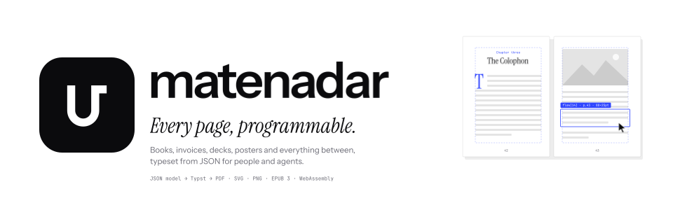

<picture>
  <source media="(prefers-color-scheme: dark)" srcset="docs/brand/banner-dark.svg">
  
</picture>

<p align="center">
  <a href="https://github.com/lvnr/matenadar/actions/workflows/ci.yml"></a>
  <a href="https://github.com/lvnr/matenadar/releases"></a>
  <a href="https://crates.io/crates/matenadar"></a>
  <a href="https://www.npmjs.com/package/matenadar"></a>
  <a href="https://www.npmjs.com/package/@matenadar/wasm"></a>
  <a href="LICENSE"></a>
</p>

<p align="center">
  <a href="https://matenadar.levships.com">Website</a> ·
  <a href="https://matenadar.levships.com/docs/">Docs</a> ·
  <a href="#install">Install</a> ·
  <a href="#quick-start">Quick start</a> ·
  <a href="docs/model.md">The model</a> ·
  <a href="#in-the-browser">WebAssembly</a> ·
  <a href="#rust">Rust</a>
</p>

**matenadar** typesets anything that prints: books and magazines, invoices and
menus, slide decks, posters, covers and calendars. A document is a JSON model
of sections, pages, styles, masters and components. **matenadar** lays it out with
[Typst](https://typst.app) and renders it to PDF, PNG or SVG. It can say what
landed where, check pages the way a print-on-demand preflighter would, and
apply edits as operations that can be undone.

It makes EPUB 3 from the same model, and runs in the browser as WebAssembly
with a page editor's API: find what is under the pointer, change words,
pictures, spacing and breaks, undo, and keep the edits as a patch that the
command line replays to the same pages.

> The banner above was typeset by **matenadar** itself: [`docs/brand/brand.py`](docs/brand/brand.py)
> writes the documents and the engine lays them out to SVG.

## Why this shape

<table>
<tr>
<td width="50%" valign="top">

**The model is the only source of truth.**
The Typst program is generated on every build and never stored or shown, so
people, book tooling and AI agents all change books through the same model
and operations.

</td>
<td width="50%" valign="top">

**Typst does the hard typesetting.**
Knuth–Plass line breaking, hyphenation, widow and orphan control, footnotes,
tables that split, variable fonts, and right-to-left and CJK text. Builds are
fast and deterministic.

</td>
</tr>
<tr>
<td valign="top">

**Designed pages are first-class.**
Fixed pages with placed elements, masters with conditional layers, margin
notes, letter grids, lettering drawn as outlines, QR codes, inline SVG, pen
marks, shadows and components. Books that once needed a hand-written
HTML/CSS engine can be expressed directly.

</td>
<td valign="top">

**Agents are first-class.**
Errors carry JSON paths. `layout` reports every node's extent on every page.
`locate` maps a point back to a node and character. `check` gives codes an
agent can act on. `serve` keeps a book open and lays it out again in
milliseconds after each operation.

</td>
</tr>
</table>

## A page, in the model

```json
{
  "matenadar": "1",
  "meta": {"title": "Smoke", "lang": "en-US"},
  "design": {
    "colors": {"ink": "#1d1b19", "accent": "#c2410c"},
    "base": {"font": "Libertinus Serif", "size": 10.5, "line_height": 1.4, "color": "ink"},
    "masters": {"body": {"width": "6in", "height": "9in", "bleed": "0.125in",
      "margins": {"top": "0.8in", "bottom": "0.9in", "inside": "0.8in", "outside": "1.6in"}}}
  },
  "content": [
    {"type": "section", "id": "ch1", "master": "body", "start": "recto", "flow": [
      {"type": "h", "id": "h1", "level": 1, "text": "Chapter One"},
      {"type": "p", "id": "p1", "content": ["It was a ", {"text": "dark", "em": true}, " and stormy night…"]}
    ]}
  ]
}
```

Then ask it what it did:

```console
$ matenadar layout smoke.json --pages 3 --json   # every node's box on page 3
$ matenadar locate smoke.json --page 3 --x 212 --y 148
$ matenadar apply smoke.json ops.json -o next.json
$ matenadar check smoke.json --safe 0.25in       # overflow, text-in-margin, widow, low-resolution…
```

[`docs/model.md`](docs/model.md) documents the model field by field.

## Install

### Command line

```bash
# Homebrew (macOS & Linux)
brew install lvnr/tap/matenadar

# npm / npx (prebuilt native binary, no Rust toolchain required)
npx matenadar --version
npm install -g matenadar

# Shell installer (macOS & Linux)
curl -fsSL https://github.com/lvnr/matenadar/releases/latest/download/install.sh | sh

# PowerShell installer (Windows)
powershell -ExecutionPolicy Bypass -c "irm https://github.com/lvnr/matenadar/releases/latest/download/install.ps1 | iex"

# Cargo (from source, or prebuilt via cargo-binstall)
cargo install matenadar
cargo binstall matenadar
```

Prebuilt archives for macOS (`arm64`, `x64`), Linux (`x64`, `arm64`), and Windows (`x64`) are also attached to every [GitHub Release](https://github.com/lvnr/matenadar/releases).

### JavaScript / TypeScript (WebAssembly)

```bash
npm install @matenadar/wasm
```

```js
import { Matenadar } from "@matenadar/wasm";

const mt = await Matenadar.load();
const { pages, diagnostics } = await mt.openFrom(doc, {
  root: "./book",
  fonts: ["./fonts"],
});
const pdf = mt.pdf();
const epub = mt.epub({ layout: "reflowable" });
```

In a browser, run the engine off the main thread with `@matenadar/wasm/client`. You can load `matenadar.wasm` straight from jsDelivr while keeping the Web Worker same-origin:

```js
import { MatenadarClient } from "@matenadar/wasm/client";

const mt = await MatenadarClient.start({
  wasm: "https://cdn.jsdelivr.net/npm/@matenadar/wasm@0.2.0/dist/matenadar.wasm",
});
await mt.addFont(await (await fetch("/fonts/LibertinusSerif-Regular.otf")).arrayBuffer());
const { pages } = await mt.open(doc);
const svg = await mt.svg(1);
```

### Rust

```bash
cargo add matenadar
```

```rust
use matenadar::{CheckOptions, Document, Paths, Session, check, validate};

let doc = Document::from_json(&std::fs::read_to_string("book.json")?)?;
assert!(validate(&doc).is_empty());

let paths = Paths {
    root: ".".into(),
    font_dirs: vec![],
    system_fonts: true,
};
let session = Session::new(doc, paths)?;
let pdf = session.pdf()?;
let issues = check(&session, &CheckOptions::default());
```

`matenadar` re-exports `matenadar::model`, `matenadar::typst` (feature `typst`), and `matenadar::epub` (feature `epub`). You can also depend on the individual crates directly—for example, `matenadar-model` alone carries no Typst dependency.

## Packages

| Package | Registry | What it provides |
|---|---|---|
| [`matenadar`](https://crates.io/crates/matenadar) | crates.io | Umbrella library crate (`model`, `typst`, `epub`) and the `matenadar` CLI |
| [`matenadar-model`](https://crates.io/crates/matenadar-model) | crates.io | JSON document model, validation, components, and reversible operations (no Typst) |
| [`matenadar-typst`](https://crates.io/crates/matenadar-typst) | crates.io | Typst generator, world, session, rendering, hit-testing, and preflight checks |
| [`matenadar-epub`](https://crates.io/crates/matenadar-epub) | crates.io | EPUB 3 export (reflowable or fixed layout with live text) |
| [`matenadar`](https://www.npmjs.com/package/matenadar) | npm | Prebuilt native CLI (`npx matenadar`) via platform `optionalDependencies` |
| [`@matenadar/wasm`](https://www.npmjs.com/package/@matenadar/wasm) | npm | Browser & Node WebAssembly engine, worker, typed client, and jsDelivr CDN bundle |
| [`lvnr/tap/matenadar`](https://github.com/lvnr/homebrew-tap) | Homebrew | Prebuilt macOS & Linux CLI formula |

## Quick start

```bash
matenadar build tests/fixtures/smoke.json -o smoke.pdf --png out --check
matenadar epub tests/fixtures/smoke.json -o smoke.epub
matenadar layout tests/fixtures/smoke.json --pages 3
matenadar bench tests/fixtures/smoke.json
```

For agent loops and editors, `matenadar serve` keeps a document laid out in memory and answers JSON-lines commands (`open`, `apply`, `render`, `pdf`, `check`, `layout`, `locate`, `position`, `document`, `save`, `quit`) over stdin/stdout in milliseconds per edit.

`matenadar help` lists all commands: `build`, `epub`, `check`, `validate`,
`layout`, `locate`, `fingerprint`, `apply`, `fonts`, `bench`,
`serve` and `--version`.

## In the browser

`scripts/wasm.sh` builds `dist/matenadar.wasm` (about 24 MB raw, ~7 MB with
brotli, zero WASM imports) and stages `packages/wasm/` (`@matenadar/wasm`)
with separate browser and Node entrypoints, a Web Worker, and a typed client.
It lays out, edits and renders in the browser with undo, hit-testing,
diagnostics after each edit, and a replayable patch whose pages match the
command line's (`fingerprint`). `scripts/wasm.sh --test` runs the parity and
smoke suite in Node. [`demo/editor/`](demo/editor/) is a sample page editor
built on it.

## Repository layout

| Path | What it holds |
|---|---|
| `crates/matenadar` | the umbrella library crate (`matenadar`) and the `matenadar` command |
| `crates/matenadar-model` | the document model, validation, components, operations (no Typst) |
| `crates/matenadar-typst` | generator, Typst world, session, inspection, checks |
| `crates/matenadar-epub` | EPUB 3, reflowable or one picture per page |
| `crates/matenadar-wasm` | the engine as WebAssembly: the page editor's API, worker, and client |
| `packages/cli` | the `matenadar` npm CLI wrapper (`npx matenadar`) |
| `packages/wasm` | the `@matenadar/wasm` npm package |
| `demo/editor/` | a page editor on the samples, running on the WebAssembly build |
| `docs/model.md` | the document model specification, field by field |
| `samples/` | real books rebuilt in **matenadar**, with compare sheets |
| `scripts/` | build, WASM, release, installer, and review scripts |
| `docs/brand/` | the banner and logo, and the script that typesets them |

## Status

- The model, generator, preflight checks, reversible operations, `serve`, and `bench` are working and shipped in `v0.1.0`.
- Eight real books are partly rebuilt under [`samples/`](samples/) (39 pages), with notes on how close each gets and remaining engine gaps.
- Print: decorative lettering is drawn as outlines so display type can cross margins and bleed while passing KDP text checks.
- EPUB 3 export (reflowable and fixed layout with live text) passes `epubcheck`.
- The WebAssembly build lays out, edits, and renders in browsers and Node with `fingerprint` parity against the native CLI.

## License

**matenadar** is open source under the Apache License, Version 2.0: see [LICENSE](LICENSE).

<p align="center">
  
  <br>
  <sub>Named after the Matenadaran (Մատենադարան), Yerevan's house of manuscripts. The mark is its initial, Մ.</sub>
</p>
