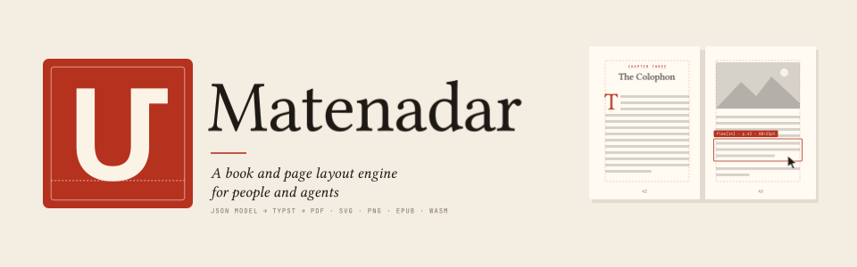

<picture>
  <source media="(prefers-color-scheme: dark)" srcset="docs/brand/banner-dark.svg">
  
</picture>

<p align="center">
  <a href="#quick-start">Quick start</a> ·
  <a href="docs/model.md">The model</a> ·
  <a href="samples/">Samples</a> ·
  <a href="#in-the-browser">WebAssembly</a> ·
  <a href="#status">Status</a>
</p>

A document is a JSON model of sections, pages, styles, masters and
components. Matenadar lays it out with [Typst](https://typst.app) and renders
it to PDF, PNG or SVG. It can say what landed where, check pages the way a
printer or KDP's previewer would, and apply edits as operations that can be
undone.

It makes EPUB 3 from the same model, and runs in the browser as WebAssembly
with a page editor's API: find what is under the pointer, change words,
pictures, spacing and breaks, undo, and keep the edits as a patch that the
command line replays to the same pages.

It is the engine behind Aldus's typesetting, and Imprimo's successor. It grew
from Imprimo's v1 plan (`docs/plans/2026-10-25-imprimo-v1.md` in the Imprimo
repository), without the NEO-related parts and the imports for now.

> The banner above was typeset by Matenadar: [`docs/brand/brand.py`](docs/brand/brand.py)
> writes the documents and the engine lays them out to SVG.

## Why this shape

<table>
<tr>
<td width="50%" valign="top">

**The model is the only source of truth.**
The Typst program is generated on every build and never stored or shown, so
people, the Aldus engine and AI agents all change books through the same
model and operations.

</td>
<td width="50%" valign="top">

**Typst does the hard typesetting.**
Knuth–Plass line breaking, hyphenation, widow and orphan control, footnotes,
tables that split, variable fonts, and right-to-left and CJK text. Builds are
fast and deterministic.

</td>
</tr>
<tr>
<td valign="top">

**Designed pages are first-class.**
Fixed pages with placed elements, masters with conditional layers, margin
notes, letter grids, lettering drawn as outlines, QR codes, inline SVG, pen
marks, shadows and components. Books that once needed a hand-written
HTML/CSS engine can be expressed directly.

</td>
<td valign="top">

**Agents are first-class.**
Errors carry JSON paths. `layout` reports every node's extent on every page.
`locate` maps a point back to a node and character. `check` gives codes an
agent can act on. `serve` keeps a book open and lays it out again in
milliseconds after each operation.

</td>
</tr>
</table>

## A page, in the model

```json
{
  "matenadar": "1",
  "meta": {"title": "Smoke", "lang": "en-US"},
  "design": {
    "colors": {"ink": "#1d1b19", "accent": "#c2410c"},
    "base": {"font": "Libertinus Serif", "size": 10.5, "line_height": 1.4, "color": "ink"},
    "masters": {"body": {"width": "6in", "height": "9in", "bleed": "0.125in",
      "margins": {"top": "0.8in", "bottom": "0.9in", "inside": "0.8in", "outside": "1.6in"}}}
  },
  "content": [
    {"type": "section", "id": "ch1", "master": "body", "start": "recto", "flow": [
      {"type": "h", "id": "h1", "level": 1, "text": "Chapter One"},
      {"type": "p", "id": "p1", "content": ["It was a ", {"text": "dark", "em": true}, " and stormy night…"]}
    ]}
  ]
}
```

Then ask it what it did:

```console
$ matenadar layout smoke.json --pages 3 --json   # every node's box on page 3
$ matenadar locate smoke.json --page 3 --x 212 --y 148
$ matenadar apply smoke.json ops.json -o next.json
$ matenadar check smoke.json --safe 0.25in       # overflow, text-in-margin, widow, low-resolution…
```

[`docs/model.md`](docs/model.md) documents the model field by field.

## Quick start

```bash
cargo build
target/debug/matenadar build tests/fixtures/smoke.json -o smoke.pdf --png out --check
target/debug/matenadar layout tests/fixtures/smoke.json --pages 3
target/debug/matenadar bench tests/fixtures/smoke.json
```

`matenadar help` lists the commands: `build`, `epub`, `check`, `validate`,
`layout`, `locate`, `apply`, `fonts`, `bench` and `serve`.

## In the browser

`scripts/wasm.sh` builds `dist/matenadar.wasm` (about 24 MB, 7 MB with
brotli, no imports) with a worker and a client. It lays out, edits and
renders in the browser, with undo, hit-testing, diagnostics after each edit,
and a patch. Its pages match the command line's (`fingerprint`).
`scripts/wasm.sh --test` runs it in Node. [`demo/editor/`](demo/editor/) is a
page editor on the samples, built on it.

## Layout

| Path | What it holds |
|---|---|
| `crates/matenadar-model` | the document model, validation, components, operations (no Typst) |
| `crates/matenadar-typst` | generator, Typst world, session, inspection, checks |
| `crates/matenadar-epub` | EPUB 3, reflowable or one picture per page |
| `crates/matenadar-wasm` | the engine as WebAssembly: the page editor's API, a worker and a client |
| `crates/matenadar-cli` | the `matenadar` command |
| `demo/editor/` | a page editor on the samples, on the WebAssembly build |
| `docs/model.md` | the model, field by field |
| `samples/` | pages of real books rebuilt in Matenadar, with compare sheets |
| `scripts/review.py` | builds a sample and sets it beside the original book's pages |
| `scripts/wasm.sh` | builds `dist/matenadar.wasm` (`--test` runs it in Node) |
| `docs/brand/` | the banner and logo, and the script that typesets them |

## Status

- The model, generator, checks, operations, `serve` and `bench` work.
- Eight of Levon's books are partly rebuilt under `samples/` (39 pages), each
  with notes on how close it gets and which engine gaps remain.
- Print: decorative elements are drawn as outlines, so display type can cross
  the margins and the bleed and still pass KDP's text checks.
- EPUB 3, reflowable or fixed layout, passes epubcheck.
- The WebAssembly build lays out, edits and renders in the browser, and its
  pages match the command line's.
- Also: opacity on photographs, clipping to ellipses and paths, and
  hyphenation exceptions.

<p align="center">
  
  <br>
  <sub>Named after the Matenadaran (Մատենադարան), Yerevan's house of manuscripts. The mark is its initial, Մ.</sub>
</p>
